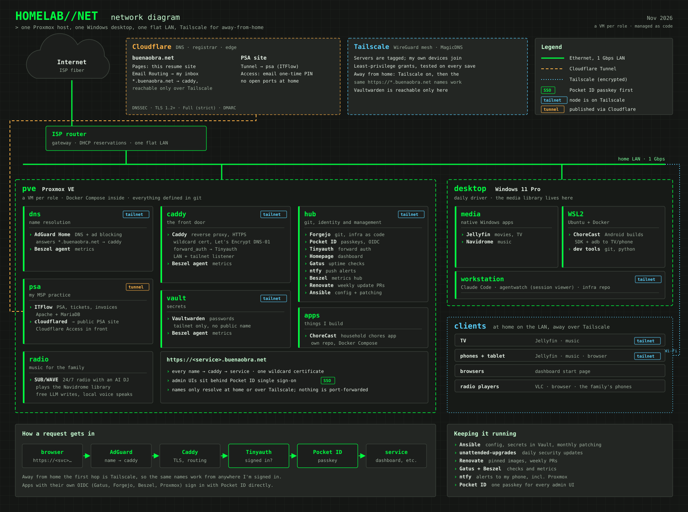

# homelab

A small production environment I run at home, managed as code. I design the
architecture, direct AI coding agents to build it, review every change, and
operate it day to day.

## What runs where

- **Proxmox VE host**, one VM per role, Docker Compose inside each:
  - **dns**: AdGuard Home for name resolution and ad blocking
  - **caddy**: the front door, a reverse proxy with one wildcard certificate
    (Let's Encrypt over DNS-01) and forward auth
  - **hub**: Forgejo (git), Pocket ID (passkeys, OIDC), Tinyauth, Homepage,
    Gatus, ntfy, Beszel, Renovate and the Ansible control node
  - **vault**: Vaultwarden, reachable only over Tailscale
  - **psa**: ITFlow for my MSP practice, published through a Cloudflare
    Tunnel with Cloudflare Access in front
  - **apps**: ChoreCast, an app I build
  - **radio**: SUB/WAVE, a 24/7 radio station for the family that plays my
    Navidrome library with an AI DJ (a free cloud LLM writes, a local voice
    speaks), public through a Cloudflare Tunnel
- **Windows desktop**: Jellyfin and Navidrome as native apps, plus WSL2 for
  Android builds

## How it's put together

- **Nothing is port-forwarded.** At home, AdGuard answers the service names
  with Caddy's address. Away from home, my devices join a Tailscale mesh and
  the same `https://` names work. The only public entry points are the PSA
  (behind Cloudflare Access) and the radio (admin pages behind Access), each
  through its own Cloudflare Tunnel.
- **One passkey for everything.** Admin UIs sit behind Pocket ID: Caddy asks
  Tinyauth on every request, and apps with their own OIDC support (Gatus,
  Forgejo, Beszel, Proxmox) sign in with Pocket ID directly.
- **Least privilege on the mesh.** Tailscale grants allow only what's needed,
  and the policy's tests block any change that would open more.
- **Everything as code.** Compose files, the Caddy config and Ansible
  playbooks live in a private repo on Forgejo. Secrets sit in Ansible Vault,
  never in plain text.

## Keeping it running

- **Ansible**: configuration, secrets from Vault, and a monthly patch run
  that updates one VM at a time and reboots only where needed
- **unattended-upgrades**: daily security updates on every VM
- **Renovate**: every image version is pinned; weekly pull requests propose
  updates, major versions wait for approval
- **Gatus + Beszel**: uptime checks and metrics
- **ntfy**: alerts to my phone, including Proxmox's own

## About this repo

This is the public overview. The real configuration lives in a private
repository, because a homelab's config is a map of how to attack it. The
diagram is generated from code; the same file is shown on
[buenaobra.net](https://buenaobra.net).
